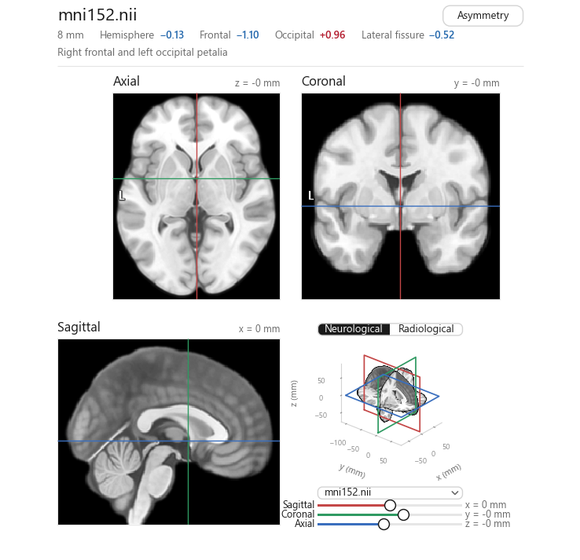

# MNI152

## Dataset

| Dataset | File in this repo | Link |
|---------|-------------------|------|
| Linear ICBM Average Brain (ICBM152) | `icbm_avg_152_t1_tal_lin.nii` | [NIFTI 41MB](https://nist.mni.mcgill.ca/icbm-152lin/) |
| MNI152 (NiiVue) | `mni152.nii` | [NIFTI 4.1MB](https://niivue.github.io/niivue-demo-images/mni152.nii.gz) |
| minimal | `minimal.nii` | [NIFTI 455B](https://nifti.nimh.nih.gov/nifti-1/data/minimal.nii.gz/file_view.html) |
| avg152T1 RL | `avg152T1_RL_nifti.nii` | [NIFTI 519kB](https://nifti.nimh.nih.gov/nifti-1/data/avg152T1_RL_nifti.nii.gz/file_view.html) |
| ICBM 2009c Nonlinear Asymmetric | `mni_icbm152_t1_tal_nlin_asym_09c.nii` | [NIFTI 57MB](https://www.bic.mni.mcgill.ca/~vfonov/icbm/2009/mni_icbm152_nlin_asym_09c_nifti.zip) |
| ICBM 2009b Nonlinear Asymmetric | `mni_icbm152_t1_tal_nlin_asym_09b_hires.nii`** | [NIFTI 358MB](https://www.bic.mni.mcgill.ca/~vfonov/icbm/2009/mni_icbm152_nlin_asym_09b_nifti.zip) |

**Not committed due to filesize

## mni152.py

View brain slices of the MNI152 dataset with visualization of brain slice planes.

```
python mni152.py [-h] [nii]
```

- `[nii]` — optional `.nii` or `.nii.gz` path. Defaults to the uncommented `PATH` in `mni152.py`.
- `[-h]` — show the usage and exit.

**Asymmetry**, in the title bar, starts off. Turning it on colors each slice by the volume minus its left–right mirror after an 8 mm blur. Red means this side is brighter than the voxel across the midline. The line under the file name is left minus right for the hemisphere, the frontal lobe, the occipital lobe, and the lateral fissure. On the ICBM asymmetric T1 the frontal number is negative and the occipital number is positive: a right frontal petalia and a left occipital petalia.

